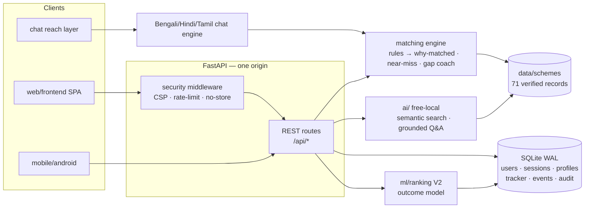

<div align="center">


# 🎓 FeeFix India

### Find the funding you qualify for.

**Personalized scholarship & fee-waiver matching platform for Indian students.**

Instead of *"Where can I find scholarships?"* — FeeFix answers
**"Which schemes fit my profile, why do I qualify, and what should I do next?"**

[](https://github.com/authorsauravkushwaha/feefix-india/actions)
[](#-testing)
[](#-the-dataset)
[](#-four-languages-native-script)
[](docs/security/SECURITY.md)
[](ai/README.md)
[](#)
[](#)
[](LICENSE)

</div>

---

FeeFix is a **decision engine, not a search engine**. A student answers a few
guided questions and gets a personalised, *ranked* set of scholarships and fee
waivers — **every match explained, every deadline tracked, every application
nudged along**, with accounts that carry their data across devices.

The dataset ships verified for **10 states + the North-East (Ishan Uday) +
national schemes** — 71 records, machine-validated in CI.

## 📲 Open the app on your phone

| What | Where |
|---|---|
| **Live web app** | Deploy **free in 5 minutes** — [`docs/deploy/DEPLOYMENT.md`](docs/deploy/DEPLOYMENT.md) (Render / Fly.io / HF Spaces free tiers). One command, one origin, opens in any phone browser → *Add to home screen* = instant app. |
| **Android app** | [`mobile/android/`](mobile/android/) — Kotlin/Compose scaffold on the same API; build in Android Studio → APK. |
| **Run locally** | `./scripts/dev.sh` → `http://localhost:8000` |

> **Try without installing anything:** the API design means any free Python
> host serves the full product (web *and* API on one URL). The deploy guide
> has copy-paste configs — then paste that URL into this repo's **Website**
> field so anyone can open it directly.

## 🎬 The product in 10 seconds

<p align="center">
</p>

Wizard → explainable ranked matches → dashboard (tracker, reminders, sign-in)
→ Ask FeeFix (grounded AI answers with citations) → chat in your own script.

## ✨ What's inside

| Layer | Where | What it does |
|---|---|---|
| **Web experience** | `web/frontend/` | Full product, no build step: guided **Smart Matcher** wizard → explainable ranked results → scheme drawer → dashboard with tracker & reminders → **Ask FeeFix** AI panel → **🔐 accounts** (your data follows your login on any device). |
| **Matching engine** | `backend/matching_engine/` | Transparent rule engine: `pass / fail / unknown` semantics — unknowns never disqualify, they become *"verify these"* assumptions. **Why-you-match** reasons · **near-miss detection** + **gap coaching**. Every rule result carries parameter slots for localization. |
| **Ranking** | `backend/matching_engine/ranker.py` | `45·clarity + urgency + benefit + verified`, deadline-aware, badges. |
| **Free-local AI** | `ai/` | Semantic search + **grounded Q&A with citations** — answers assembled only from verified dataset fields (+ near-miss radar). In-process embeddings (`fastembed`/MiniLM or built-in sublinear-TF n-gram embedder). **No paid APIs, ever.** |
| **ML outcome ranking (V2)** | `ml/ranking/` · `POST /api/events` · `GET /api/ml/rank` | Tracker buttons (`viewed/applied/approved/…`) stream outcome events with their V1 signal snapshots → tiny logistic model re-ranks matches (**⚡ ML preview** toggle, synthetic bootstrap until ≥25 real events). *Same signals V1 uses — no invented facts.* |
| **Security & accounts** | `backend/services/` · `agents/secret_scan.py` · `.github/workflows/ci.yml` | **Argon2id** passwords (PBKDF2-600k for legacy rows, re-hashed on login) · SHA-256-hashed revocable session tokens with replay tolerance that can't log you out everywhere · sliding-window rate limits **shared across instances via Redis** · per-endpoint body limits enforced mid-stream · hardened upload gate wired to real routes · boot-time secret hygiene that **refuses to start** on placeholders in production · **real OTP delivery** (SMTP/Brevo/Resend/Twilio/MSG91/Fast2SMS/Vonage/webhook) with credentials-free audit logging, per-destination hourly/daily caps against SMS-pumping, and a production mode that **never** returns a sign-in code it could not deliver · secret scan + gitleaks + bandit + pip-audit in CI · CSP/HSTS/nosniff/no-store · CORS closed by default · append-only audit log · uniform login errors · **data export + right-to-erasure**. → [`docs/security/SECURITY.md`](docs/security/SECURITY.md) |
| **Storage** | `backend/services/sqlite_store.py` | **SQLite (WAL mode)** — ACID, crash-safe, indexed, FK-enforced, versioned migrations, legacy JSONL auto-import. Postgres swap = one module (documented). |
| **Data & verification** | `data/` | 71 curated schemes as structured, validated records + per-record **verification manifest**; `agents/verify_dataset.py` gates CI. |
| **Reach layer** | `backend/services/chat.py` + `chat_i18n.py` | WhatsApp-style conversational matcher — *State → Course → Income → matches → free-text Q&A* — in **English, বাংলা, हिन्दी & தமிழ்** (native script detection, দেশি digits `২ লাখ`, Tamil `லட்சம்`, NFC-safe matching). |
| **Agents** | `agents/` | Dataset verification agent (health audit + CI gate) · reminder scheduler (cron-friendly dispatcher). |
| **Notifications** | `backend/notifications/` | Channel-agnostic reminders (console + WhatsApp outbox demo). |
| **Android** | `mobile/android/` | Kotlin/Compose reference scaffold on the same API contract. |
| **CI** | `.github/workflows/` | Tests (incl. property-based + real multi-process limiter) + API fuzz run + dependency audit (`pip-audit`) + clipboard behaviour tests + secret scan **with git history and a wiring self-check** + dataset agent + ML sanity + scheduler dry-run — free GitHub Actions. |

## 🗺 Architecture



## 🧠 A match, explained

```bash
curl -X POST http://localhost:8000/api/match -H 'Content-Type: application/json' \
  -d '{"profile": {"domicile_state": "West Bengal", "category": "obc",
       "annual_family_income": 95000, "course_level": "ug", "gender": "female",
       "last_exam_percentage": 71}}'
```

```
→ matches[0]: aicte-pragati  score 88
  why_matched:
    ✓ Your family income (₹95,000) is within the ₹8,00,000 limit.
    ✓ Your gender matches the scheme's requirement.
  badges: [top_pick, high_value, all_india, verified]   days_left: 34

→ near_misses[0]: nsp-central-sector
  single blocker: Needs ≥80% in the last exam; you reported 71.0%.
  gap advice: improve the score or target schemes without the merit bar →
```

## 🗣 Four languages, native script

The entire surface — UI, match explanations, and full chat conversations — runs in **English, বাংলা, हिन्दी and தமிழ்**:

```
🤖 *প্রশ্ন ১ / ৩:* আপনার অধিবাস কোন রাজ্যে?
👤 পশ্চিমবঙ্গ
🤖 ✅ ঠিক আছে: West Bengal। *প্রশ্ন ২ / ৩:* আপনি এখন কী পড়ছেন?
👤 বি.টেক
🤖 *প্রশ্ন ৩ / ৩:* বার্ষিক পারিবারিক আয়?
👤 ২ লাখ
🤖 🎯 আপনার প্রোফাইলের সাথে 6টি প্রকল্প মিলেছে। …
```

Native digits (২ লাখ / २ लाख / 2 லட்சம்), 30+ Bengali/Hindi/Tamil state names,
Unicode-NFC-safe keyword matching.

The language picker in the nav switches the **whole page** — wizard option
cards, the scheme drawer's eligibility grid, the dashboard, the chat panel —
in the chosen script, and the choice is remembered across visits. All four
dictionaries carry the same 167 keys (a missing key would leave a raw
`badge.top_pick` on screen), and a language that fails to load falls back to
English rather than to empty strings. `test_web_i18n` proves both.

## 🗄 The dataset

**71 verified schemes:** West Bengal · Bihar · Odisha · Uttar Pradesh ·
Maharashtra · Jharkhand · Tamil Nadu · Assam · Karnataka · Kerala ·
North-East-wide Ishan Uday · national pool.

Every record carries: official portal link · benefit + display string ·
deadline or rolling flag · full eligibility DSL · documents · step-by-step
application guide · verification status (`verified` | `pending_review`) ·
last-verified date · curator notes where figures shift between cycles.
Invariant-tested in CI (unique ids, https sources, manifest coverage).

## 🚀 Quickstart

```bash
git clone https://github.com/authorsauravkushwaha/feefix-india.git
cd feefix-india
./scripts/dev.sh          # creates venv, installs deps, serves on :8000
# open http://localhost:8000
```

```bash
./scripts/dev.sh --test                       # full suite
.venv/bin/python -m agents.verify_dataset     # dataset health audit
.venv/bin/python -m ml.experiments.simulate_outcomes   # V2 ranker demo
```

## 🔐 Sign in once, keep your progress

Accounts are **optional** — everything works anonymously. Sign in and the
anonymous wizard session binds to your account: matches, tracker board and
reminders follow the login on any device. Log out → fresh anonymous session.
Export or erase your data anytime (`docs/api/API.md` → Accounts).

Sign-in doors: **password** (Argon2id), **email code**, **phone code** (any
country, E.164) and **GitHub OAuth**. Codes are really delivered — SMTP (Gmail
app password, Yahoo, Outlook, SES, …), Brevo/Resend/your own webhook for email,
Twilio / MSG91 / Fast2SMS / Vonage / your own webhook for SMS — and the response
tells you which gateway carried the message. With **no gateway configured**:
outside production the code is a clearly labelled *demo* (server log,
`runtime/otp_outbox.jsonl`, `GET /api/auth/otp/dev-inbox`), and in production
code sign-in answers `503` with the variables to set instead of faking one.
Check a deployment in one command —
`python scripts/check_otp_delivery.py --email you@gmail.com` — or read
`GET /api/health` → `otp_delivery`. Setup: `docs/deploy/DEPLOYMENT.md`
(real OTP delivery).

## 🧪 Testing

| Suite | Covers |
|---|---|
| `test_matching_engine` | rules, explanations, near-misses |
| `test_ranking` | scoring, deadlines, badges, determinism |
| `test_dataset` | 71-record integrity + per-state match scenarios |
| `test_api` · `test_ml_api` | REST contract, events, V2 compare endpoint |
| `test_auth` | register/login, token revocation, ownership 403s, rate limits, headers, export/erase, **no-plaintext-DB proof** |
| `test_password_hashing` | Argon2id parameters, fail-closed production boot, PBKDF2→Argon2id migration on login |
| `test_session_replay_policy` | rotation, overlap tolerance, strike-based revocation — the live session survives |
| `test_ratelimit_distributed` | two real worker processes, shared Redis counters, XFF spoofing, fail modes |
| `test_body_limits` | per-endpoint caps, mid-stream abort → 413, env overrides, absolute clamp |
| `test_uploads` | magic bytes, quotas, traversal, ownership, the wired routes |
| `test_numerals` · `test_fuzz_security` | table-driven income parsing + property-based/adversarial pass (hypothesis) |
| `test_secret_hygiene` · `test_schema_migrations` | scanner bypasses, strict boot, concurrent/crashed migrations |
| `test_otp_auth` · `test_otp_delivery` | normalisation, expiry, attempt burning, per-destination caps + **every delivery path**: SMTP TLS/STARTTLS, retries, Twilio/MSG91/Fast2SMS/Vonage/webhook payloads, provider errors, and the production rule that a code is never echoed |
| `test_clipboard_js` | executes `secure-clipboard.js` in node (18 checks) — and asserts it claims no security control |
| `test_ci_config` | parses CI + pre-commit, runs their commands, and fails if a gate is mis-wired or demoted to advisory |
| `test_chat` · `test_i18n_rules` | 4-language parsing + full conversations + localized explanations |
| `test_web_i18n` | the language switch (executed in node against the real `app.js`) + dictionary parity: no missing key, no raw enum value, no string left in English |
| `test_ai` · `test_agents` | grounding, search rankings, verifier, scheduler |
| `test_password_hashing` | Argon2id default, legacy-hash upgrade on login, scrypt fallback, bounded KDF concurrency |
| `test_rate_limit_shared` | the limiter across **real OS processes** (and the multiplication the in-memory store causes) |
| `test_session_reuse_policy` | replay quarantine vs. escalation vs. opt-in family revoke, `logout-all`, security events |
| `test_uploads_api` | upload → list → download → delete, traversal, spoofed/oversized files, ownership, erasure |
| `test_body_limits` | per-endpoint caps + the chunked/no-`Content-Length` bypass |
| `test_numerals_i18n` | the data-driven income lexicon, script validation, Hypothesis properties |
| `test_fuzzing` | randomised probing of every route + property tests on parsers, tokens, HTML-safe JSON |
| `test_wiring_and_claims` | controls are still wired in (no dead code), CI jobs intact, **docs match the code** |

## 📁 Repository map

```
feefix-india/
├── backend/
│   ├── api/                 # routes + request schemas
│   ├── matching_engine/     # rules · engine · ranker  (the core)
│   ├── models/              # StudentProfile · Scheme (pydantic)
│   ├── services/            # dataset · matching · tracker(SQLite WAL) · chat · events ·
│   │                        # auth · db · ratelimit · secure_headers · i18n
│   ├── notifications/       # notifier abstraction + WhatsApp outbox
│   └── main.py              # FastAPI app (API + static SPA, one origin)
├── ai/                      # FREE-ONLY AI: lexicon · embeddings · search · grounded Q&A
├── agents/                  # dataset verification agent · reminder scheduler agent
├── data/
│   ├── schemes/             # 10 state files + national incl. NER Ishan Uday (71 schemes)
│   ├── eligibility_rules/   # the rule DSL documentation
│   └── verification/        # verification manifest
├── docs/                    # architecture · API · security · deploy · dataset schema
├── web/frontend/            # the FeeFix web experience (no build step)
├── mobile/android/          # Kotlin scaffold (same API contract)
├── ml/                      # V2 outcome ranker + experiments + events-trained service
├── language/regional_support/  # en/bn/hi/ta dictionaries + explanation templates
├── .github/workflows/       # CI: tests · secret scan + gitleaks · bandit + pip-audit · dataset (free)
│                            #     gates are themselves tested (tests/test_ci_config.py)
├── scripts/dev.sh           # one-command dev bootstrap
├── scripts/verify.sh        # every CI gate locally, one command
└── tests/                   # suite: units · property-based · multi-process · wiring claims
```

## 🔍 Security: what is proven, and what is not

Security claims age badly, so this project states the boundary out loud:

**Verified by tests in this repository** — memory-hard **Argon2id** password
storage (legacy PBKDF2 rows re-hash on next sign-in); session rotation with
replay detection that **quarantines** the replayed token instead of logging the
user out everywhere; a rate limiter whose counters are **shared across
processes**, proven by spawning real ones; **per-endpoint** body caps enforced
while the body streams (chunked requests included); a hardened document-upload
pipeline that is actually **called by a route**; a secret scan that reads git
history, flags entropy and split literals, and verifies its own CI wiring;
strict-mode boot that **refuses to start** on placeholder secrets.

**Not proven** — there has been **no third-party penetration test and no external
security review**. The suite, the property-based tests and the fuzzer were
written by the same author as the code, so they share its blind spots. The
fuzzer is a TestClient harness (no TLS, no proxy, no browser). DoS resistance is
argued from bounded work per request, not measured under a real flood. A copied
value is still readable by clipboard malware — the clipboard helper is UX
hygiene, and says so. Run the evidence yourself:

```bash
python -m pytest                                       # suite
python -m scripts.fuzz_api --requests 2000 --seed 1     # randomised API probing
python -m pytest tests/test_rate_limit_shared.py        # limiter across processes
python -m agents.secret_scan --history --check-ci       # secrets + CI wiring
node --test "web/tests/*.test.mjs"                      # clipboard behaviour
```

## 🗺 Roadmap

- [x] **Phase 1 — West Bengal**: verified dataset, rule-based explainable matcher ✅
- [x] **Phase 2 — Multi-state + agents + free-local AI**: Bihar & Odisha, AI layer, verification agent, CI ✅
- [x] **Phase 3 — ML ranking**: outcome events + logistic reranker live behind ⚡ ML preview ✅
- [x] **Phase 4 — Language depth**: full conversations + localized explanations in Bengali/Hindi ✅
- [x] **Phase 5 — National footprint**: UP, Maharashtra, Jharkhand, Tamil Nadu, Assam, Karnataka, Kerala + Ishan Uday; Tamil as 4th language ✅
- [x] **v1.1 — Trust layer**: accounts & sign-in, CIA-mapped hardening, SQLite WAL, export/erasure ✅
- [x] **v1.2 — Adversarial hardening**: Argon2id · per-endpoint body limits · Redis-shared rate limiting · replay policy without self-DoS · hardened upload routes · secret-scan/SAST/SBOM CI gates · fuzz + distributed + migration-race suites ✅
- [ ] **Next** — more states (Gujarat, Rajasthan, MP…) + te/mr templates · deployed public link (see `docs/deploy/`) · college-partner dispatch channels · TOTP second factor · **independent third-party review / pen test** (hand-written tests prove consistency, not security — see `HARDENING.md`)

## ⚖️ Data disclaimer

Benefit amounts, cut-offs and deadlines in `data/` are indicative of recent
public cycles and marked with a curator `notes` field where they shift. Every
record carries an official source, a verification date and a status; always
verify on the official portal before applying. [`data/README.md`](data/README.md)
documents the verification workflow.

## 🤝 Contributing

Adding a state is a *data* contribution, not a code one — see
[`CONTRIBUTING.md`](CONTRIBUTING.md). Security issues: please use
[`docs/security/SECURITY.md`](docs/security/SECURITY.md) (private advisory, not public issues).

## 📄 License

[MIT](LICENSE) — free for students, forever. Built with free, open-source
tools only: no paid APIs, no API keys, no cloud bills.

---

<div align="center"><b>Discover. Understand. Apply. Track.</b><br>
<sub>Made in Kolkata, for every student in India.</sub></div>
